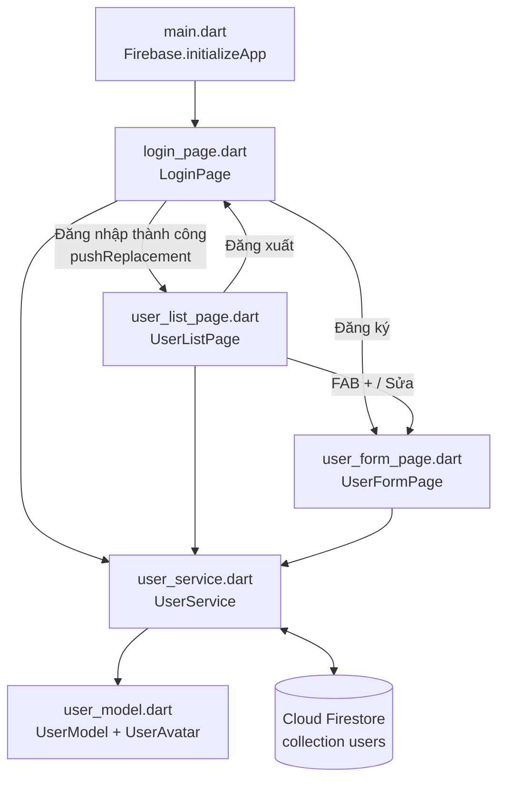
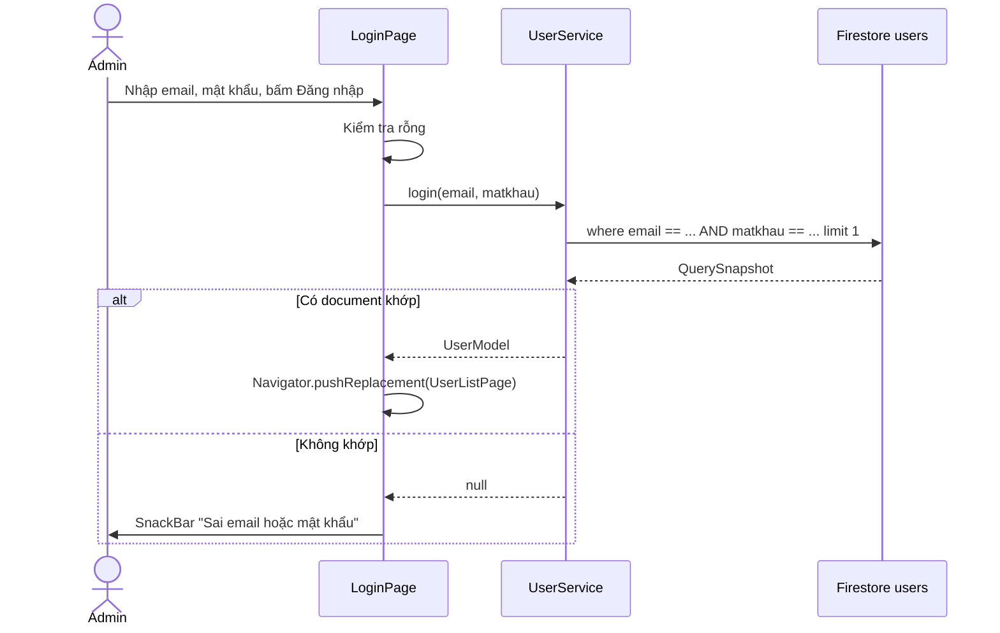
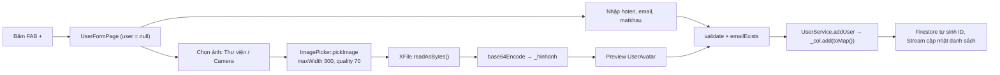

# BÁO CÁO GIỮA KỲ - MÔN LẬP TRÌNH ĐA NỀN TẢNG

**Đề tài:** Xây dựng ứng dụng quản lý người dùng ở phân hệ Admin kết nối cơ sở dữ liệu Firebase Cloud Firestore

---

## 1. THÔNG TIN CHUNG & KẾT QUẢ ĐẠT ĐƯỢC

### 1.1. Thông tin sinh viên

| Thông tin | Nội dung |
|---|---|
| Họ và tên | Đặng Thần Cầu |
| Mã sinh viên | 23IT025 |
| Link GitHub source code | https://github.com/thancau04/flutter_midterm |
| Link video demo | https://drive.google.com/file/d/1V5DMrV2_EJc9Vy96Jeypv4UCwUIbS-M6/view?usp=sharing |
| File CSDL nộp kèm (`users.json`) | https://drive.google.com/file/d/1Uff9WJr68g38CV_UMdoNVJY34jYXTwZa/view?usp=sharing |

### 1.2. Môi trường phát triển

| Thành phần | Phiên bản / Thông tin |
|---|---|
| Flutter SDK / Dart SDK | Dart v3.13.7 |
| IDE | Visual Studio Code |
| Nền tảng Web | Trình duyệt Brave |
| Nền tảng Mobile | Điện thoại Android thật (device id: `2510DRK44C`) |
| Cơ sở dữ liệu | Firebase Cloud Firestore (Project ID: `midterm-app-f2c16`) |
| Thư viện chính | `firebase_core` v5.1.0, `cloud_firestore` v7.1.0, `image_picker` v1.2.4 |

### 1.3. Tóm tắt kết quả đạt được (theo thang điểm đề bài)

| STT | Yêu cầu | Điểm | Kết quả |
|---|---|---|---|
| 1 | Chạy trên **Web**: thêm và hiển thị thông tin người dùng (kết nối Firestore, collection `users`) | 8.0 | ✅ Hoàn thành — Thêm người dùng qua form, danh sách hiển thị realtime bằng `StreamBuilder` |
| 2 | **Đăng nhập, Xóa, Sửa, Tìm kiếm** và chức năng nâng cao | 1.5 | ✅ Hoàn thành — Đăng nhập Admin từ Firestore; Sửa / Xóa (có hộp thoại xác nhận); Tìm kiếm realtime theo họ tên / email. **Nâng cao:** Xuất CSDL ra `users.json`, kiểm tra trùng email, validate form, xem chi tiết người dùng, ẩn/hiện mật khẩu, đăng xuất |
| 3 | **Nhập hình ảnh từ thiết bị** và hiển thị người dùng trên **Android** | 0.5 | ✅ Hoàn thành — `ImagePicker` chọn ảnh từ thư viện / camera, nén ảnh, mã hóa Base64 lưu vào `hinhanh`, hiển thị trên máy thật Android |

### 1.4. Cấu trúc cơ sở dữ liệu (tuân thủ tuyệt đối đề bài)

- **Collection:** `users`
- **Mỗi document chỉ gồm đúng 4 trường:**

| Trường | Kiểu | Ý nghĩa |
|---|---|---|
| `email` | String | Email người dùng (dùng để đăng nhập) |
| `matkhau` | String | Mật khẩu |
| `hoten` | String | Họ và tên |
| `hinhanh` | String | Chuỗi Base64 của ảnh chọn từ thiết bị **hoặc** URL ảnh |

> **Lưu ý:** ID của document do Firestore tự sinh (`DocumentSnapshot.id`) và chỉ được dùng trong bộ nhớ ứng dụng để Sửa/Xóa — **không** được ghi vào map dữ liệu của document. Ứng dụng không lưu thêm bất kỳ trường nào khác (`id`, `role`, `createdAt`, …).

### 1.5. Sơ đồ kiến trúc ứng dụng



---

## 2. CÁC BƯỚC CÀI ĐẶT VÀ CẤU HÌNH FIREBASE TRONG FLUTTER

### Bước 2.1. Tạo project Firebase và bật Cloud Firestore

1. Truy cập https://console.firebase.google.com → **Add project** → đặt tên project (`midterm-app`) → tạo project (Project ID: `midterm-app-f2c16`).
2. Vào menu **Build → Firestore Database → Create database** → chọn vị trí server → chọn chế độ khởi tạo.

`[Chèn ảnh chụp màn hình tạo project trên Firebase Console tại đây]`

`[Chèn ảnh chụp màn hình bật Cloud Firestore (Create database) tại đây]`

### Bước 2.2. Cấu hình Security Rules cho Firestore

Vào tab **Rules** của Firestore và cấu hình cho phép đọc/ghi collection `users`:

```javascript
rules_version = '2';
service cloud.firestore {
  match /databases/{database}/documents {
    match /users/{id} {
      allow read, write: if true;
    }
  }
}
```

Bấm **Publish** để áp dụng.

`[Chèn ảnh chụp màn hình Firestore Rules đã Publish tại đây]`

### Bước 2.3. Khởi tạo project Flutter

```bash
flutter create flutter_midterm
cd flutter_midterm
```

Cấu hình chạy Web bằng trình duyệt Brave (PowerShell):

```powershell
setx CHROME_EXECUTABLE "C:\Program Files\BraveSoftware\Brave-Browser\Application\brave.exe"
flutter devices
```

`[Chèn ảnh chụp màn hình kết quả lệnh flutter devices (có Chrome/Brave và máy Android 2510DRK44C) tại đây]`

### Bước 2.4. Cài đặt thư viện

Lệnh tải thư viện:

```bash
flutter pub add firebase_core cloud_firestore image_picker
```

| Thư viện | Công dụng |
|---|---|
| `firebase_core` | Khởi tạo kết nối Firebase cho ứng dụng |
| `cloud_firestore` | Đọc / ghi / truy vấn dữ liệu trên Cloud Firestore |
| `image_picker` | Chọn ảnh từ thư viện hoặc chụp ảnh bằng camera (Web & Android) |

`[Chèn ảnh chụp màn hình Terminal chạy lệnh flutter pub add thành công tại đây]`

Sau khi chạy lệnh, phần `dependencies` trong `pubspec.yaml`:

```yaml
dependencies:
  flutter:
    sdk: flutter

  # The following adds the Cupertino Icons font to your application.
  # Use with the CupertinoIcons class for iOS style icons.
  cupertino_icons: ^1.0.8
  firebase_core: ^5.1.0
  cloud_firestore: ^7.1.0
  image_picker: ^1.2.4
```

`[Chèn ảnh chụp màn hình file pubspec.yaml tại đây]`

### Bước 2.5. Cấu hình FlutterFire (kết nối Flutter với Firebase)

```bash
# Cài Firebase CLI (yêu cầu Node.js) và đăng nhập
npm install -g firebase-tools
firebase login

# Cài FlutterFire CLI
dart pub global activate flutterfire_cli

# Cấu hình project (chọn project midterm-app-f2c16, chọn nền tảng web + android)
flutterfire configure
```

Kết quả: lệnh sinh tự động file `lib/firebase_options.dart` (chứa `DefaultFirebaseOptions.currentPlatform` cho Web, Android, …), file `firebase.json` ở thư mục gốc và file `android/app/google-services.json`.

`[Chèn ảnh chụp màn hình Terminal chạy flutterfire configure thành công tại đây]`

`[Chèn ảnh chụp màn hình file lib/firebase_options.dart tại đây]`

`[Chèn ảnh chụp màn hình Project settings → Your apps (Web app + Android app) trên Firebase Console tại đây]`

### Bước 2.6. Khởi tạo Firebase trong ứng dụng

Trong `lib/main.dart` gọi:

```dart
WidgetsFlutterBinding.ensureInitialized();
await Firebase.initializeApp(options: DefaultFirebaseOptions.currentPlatform);
```

(Chi tiết toàn bộ file ở Mục 3.1.)

### Bước 2.7. Chạy ứng dụng

```bash
# Chạy trên Web (Brave)
flutter run -d chrome
# hoặc
flutter run -d web-server

# Chạy trên máy thật Android
flutter run -d 2510DRK44C
```

`[Chèn ảnh chụp màn hình ứng dụng chạy trên Web (Brave) tại đây]`

`[Chèn ảnh chụp màn hình ứng dụng chạy trên điện thoại Android tại đây]`

### Bước 2.8. Cấu trúc thư mục `lib/`

```text
lib/
├── firebase_options.dart   # Sinh tự động bởi flutterfire configure
├── main.dart               # Điểm khởi chạy, khởi tạo Firebase
├── user_model.dart         # Model UserModel (4 trường) + widget UserAvatar
├── user_service.dart       # Đóng gói CRUD / Login / Export JSON với Firestore
├── login_page.dart         # Màn hình đăng nhập Admin
├── user_list_page.dart     # Màn hình danh sách: Read / Search / Delete / Export
└── user_form_page.dart     # Form dùng chung Create / Update + ImagePicker
```

`[Chèn ảnh chụp màn hình cây thư mục lib/ trong VS Code tại đây]`

---

## 3. CHI TIẾT CẤU TRÚC & TOÀN BỘ SOURCE CODE 6 FILE TRONG `lib/`

### 3.1. `lib/main.dart`

**Vai trò:** Điểm khởi chạy của ứng dụng.

- `main()`: gọi `WidgetsFlutterBinding.ensureInitialized()` để đảm bảo Flutter engine sẵn sàng, sau đó `await Firebase.initializeApp(...)` với cấu hình `DefaultFirebaseOptions.currentPlatform` (tự chọn cấu hình Web hoặc Android).
- `MyApp`: `MaterialApp` dùng Material 3, tắt banner debug (`debugShowCheckedModeBanner: false`), màn hình đầu tiên là `LoginPage`.

```dart
import 'package:firebase_core/firebase_core.dart';
import 'package:flutter/material.dart';

import 'firebase_options.dart'; // sinh bởi: flutterfire configure (project midterm-app)
import 'login_page.dart';

Future<void> main() async {
  WidgetsFlutterBinding.ensureInitialized();
  await Firebase.initializeApp(options: DefaultFirebaseOptions.currentPlatform);
  runApp(const MyApp());
}

class MyApp extends StatelessWidget {
  const MyApp({super.key});

  @override
  Widget build(BuildContext context) {
    return MaterialApp(
      title: 'Quản lý người dùng',
      debugShowCheckedModeBanner: false,
      theme: ThemeData(colorSchemeSeed: Colors.indigo, useMaterial3: true),
      home: const LoginPage(),
    );
  }
}
```

`[Chèn ảnh chụp code main.dart tại đây]`

---

### 3.2. `lib/user_model.dart`

**Vai trò:** Định nghĩa dữ liệu người dùng và widget hiển thị ảnh đại diện.

- Class `UserModel`:
  - `id` (nullable): lấy từ `DocumentSnapshot.id`, chỉ dùng cho Sửa/Xóa, **không** đưa vào `toMap()`.
  - Đúng 4 thuộc tính dữ liệu: `email`, `matkhau`, `hoten`, `hinhanh`.
  - `UserModel.fromMap(map, id)` và `UserModel.fromFirestore(doc)`: chuyển dữ liệu Firestore → đối tượng Dart.
  - `toMap()`: trả về Map **chỉ gồm 4 key** `email`, `matkhau`, `hoten`, `hinhanh`.
  - `isImageUrl`: kiểm tra `hinhanh` có phải link `http/https`.
  - `decodeBase64(s)`: giải mã chuỗi Base64 (hỗ trợ cả tiền tố `data:image/...;base64,`), trả về `null` nếu lỗi.
- Widget `UserAvatar`: ảnh đại diện tròn, **tự nhận diện** URL → `Image.network`, Base64 → `Image.memory`; nếu rỗng/lỗi thì hiện icon người dùng.

```dart
import 'dart:convert';
import 'dart:typed_data';

import 'package:cloud_firestore/cloud_firestore.dart';
import 'package:flutter/material.dart';

/// Model người dùng - CHỈ có đúng 4 trường dữ liệu theo đề:
/// email, matkhau, hoten, hinhanh.
/// `id` là ID của document trên Firestore (dùng để Sửa/Xóa),
/// KHÔNG phải trường dữ liệu và KHÔNG được đưa vào toMap().
class UserModel {
  final String? id;
  final String email;
  final String matkhau;
  final String hoten;
  final String hinhanh; // chuỗi Base64 của ảnh hoặc URL ảnh (rỗng nếu chưa có)

  UserModel({
    this.id,
    required this.email,
    required this.matkhau,
    required this.hoten,
    this.hinhanh = '',
  });

  /// Đọc dữ liệu từ Map + id document
  factory UserModel.fromMap(Map<String, dynamic> map, String id) {
    return UserModel(
      id: id,
      email: (map['email'] ?? '').toString(),
      matkhau: (map['matkhau'] ?? '').toString(),
      hoten: (map['hoten'] ?? '').toString(),
      hinhanh: (map['hinhanh'] ?? '').toString(),
    );
  }

  /// Đọc dữ liệu trực tiếp từ DocumentSnapshot của Firestore
  factory UserModel.fromFirestore(DocumentSnapshot doc) {
    final data = (doc.data() as Map<String, dynamic>?) ?? <String, dynamic>{};
    return UserModel.fromMap(data, doc.id);
  }

  /// Ghi lên Firestore - CHỈ đúng 4 key
  Map<String, dynamic> toMap() => {
    'email': email,
    'matkhau': matkhau,
    'hoten': hoten,
    'hinhanh': hinhanh,
  };

  /// true nếu hinhanh là link ảnh (http/https)
  bool get isImageUrl =>
      hinhanh.startsWith('http://') || hinhanh.startsWith('https://');

  /// Giải mã Base64 (hỗ trợ cả dạng "data:image/png;base64,....")
  static Uint8List? decodeBase64(String s) {
    if (s.isEmpty) return null;
    try {
      final raw = s.contains(',') ? s.substring(s.indexOf(',') + 1) : s;
      return base64Decode(raw.trim());
    } catch (_) {
      return null;
    }
  }
}

/// Widget ảnh đại diện tròn: tự nhận diện URL (Image.network) hoặc Base64 (Image.memory).
class UserAvatar extends StatelessWidget {
  final String hinhanh;
  final double radius;
  const UserAvatar({super.key, required this.hinhanh, this.radius = 24});

  @override
  Widget build(BuildContext context) {
    final size = radius * 2;
    final placeholder = Icon(Icons.person, size: radius);
    Widget? img;

    if (hinhanh.startsWith('http://') || hinhanh.startsWith('https://')) {
      img = Image.network(
        hinhanh,
        width: size,
        height: size,
        fit: BoxFit.cover,
        errorBuilder: (context, error, stack) => placeholder,
      );
    } else {
      final bytes = UserModel.decodeBase64(hinhanh);
      if (bytes != null) {
        img = Image.memory(
          bytes,
          width: size,
          height: size,
          fit: BoxFit.cover,
          errorBuilder: (context, error, stack) => placeholder,
        );
      }
    }

    return CircleAvatar(
      radius: radius,
      child: img == null ? placeholder : ClipOval(child: img),
    );
  }
}
```

`[Chèn ảnh chụp code user_model.dart tại đây]`

---

### 3.3. `lib/user_service.dart`

**Vai trò:** Lớp dịch vụ (service layer) đóng gói toàn bộ thao tác với `FirebaseFirestore.instance.collection('users')`.

| Hàm | Chức năng | API Firestore sử dụng |
|---|---|---|
| `getUsersStream()` | READ — trả về `Stream<List<UserModel>>` realtime | `snapshots()` |
| `addUser(user)` | CREATE — thêm document mới, Firestore tự sinh ID | `add(user.toMap())` |
| `updateUser(id, user)` | UPDATE — ghi đè document theo ID (đảm bảo chỉ còn đúng 4 trường) | `doc(id).set(user.toMap())` |
| `deleteUser(id)` | DELETE — xóa document theo ID | `doc(id).delete()` |
| `emailExists(email, exceptId)` | Kiểm tra trùng email khi thêm/sửa | `where('email', isEqualTo: ...)` |
| `login(email, matkhau)` | LOGIN — truy vấn kết hợp email + mật khẩu | `where(...).where(...).limit(1).get()` |
| `exportUsersJson()` | Xuất toàn bộ `users` ra JSON (chỉ 4 trường) | `get()` + `JsonEncoder.withIndent` |

```dart
import 'dart:convert';

import 'package:cloud_firestore/cloud_firestore.dart';

import 'user_model.dart';

/// Đóng gói toàn bộ thao tác với collection `users` trên Cloud Firestore.
class UserService {
  final CollectionReference<Map<String, dynamic>> _col = FirebaseFirestore
      .instance
      .collection('users');

  /// Tài khoản Admin mặc định - chỉ dùng khi CSDL đang trống
  static const String defaultEmail = 'admin@gmail.com';
  static const String defaultPassword = '123456';

  /// READ - danh sách người dùng realtime
  Stream<List<UserModel>> getUsersStream() {
    return _col.snapshots().map(
      (snap) => snap.docs.map((d) => UserModel.fromFirestore(d)).toList(),
    );
  }

  /// CREATE - thêm document mới (Firestore tự sinh id)
  Future<void> addUser(UserModel user) => _col.add(user.toMap());

  /// UPDATE - ghi đè document theo id, đảm bảo chỉ còn đúng 4 trường
  Future<void> updateUser(String id, UserModel user) =>
      _col.doc(id).set(user.toMap());

  /// DELETE - xóa document theo id
  Future<void> deleteUser(String id) => _col.doc(id).delete();

  /// Kiểm tra email đã tồn tại (bỏ qua chính document đang sửa)
  Future<bool> emailExists(String email, {String? exceptId}) async {
    final q = await _col.where('email', isEqualTo: email).get();
    return q.docs.any((d) => d.id != exceptId);
  }

  /// LOGIN - so khớp email + matkhau trong Firestore.
  /// Nếu CSDL trống: cho phép đăng nhập bằng tài khoản mặc định
  /// (admin@gmail.com / 123456) và tạo luôn tài khoản đó (đúng 4 trường).
  Future<UserModel?> login(String email, String matkhau) async {
    final q = await _col
        .where('email', isEqualTo: email)
        .where('matkhau', isEqualTo: matkhau)
        .limit(1)
        .get();
    if (q.docs.isNotEmpty) return UserModel.fromFirestore(q.docs.first);

    if (email == defaultEmail && matkhau == defaultPassword) {
      final any = await _col.limit(1).get();
      if (any.docs.isEmpty) {
        final admin = UserModel(
          email: defaultEmail,
          matkhau: defaultPassword,
          hoten: 'Administrator',
        );
        final ref = await _col.add(admin.toMap());
        return UserModel.fromMap(admin.toMap(), ref.id);
      }
    }
    return null;
  }

  /// Xuất toàn bộ collection `users` ra chuỗi JSON (chỉ 4 trường) để lưu users.json
  Future<String> exportUsersJson() async {
    final snap = await _col.get();
    final list = snap.docs
        .map((d) => UserModel.fromFirestore(d).toMap())
        .toList();
    return const JsonEncoder.withIndent('  ').convert(list);
  }
}
```

`[Chèn ảnh chụp code user_service.dart tại đây]`

---

### 3.4. `lib/login_page.dart`

**Vai trò:** Màn hình đăng nhập Admin.

- 2 ô nhập `Email` và `Mật khẩu` (có nút ẩn/hiện mật khẩu, nhấn Enter để đăng nhập).
- `_login()`: kiểm tra rỗng → gọi `UserService.login()` → nếu đúng thì `Navigator.pushReplacement` sang `UserListPage` (không quay lại được màn hình đăng nhập bằng nút Back), nếu sai hiện `SnackBar` "Sai email hoặc mật khẩu".
- Hiển thị vòng xoay loading trong lúc truy vấn Firestore.
- Nút "Chưa có tài khoản? Đăng ký" mở `UserFormPage` để tạo tài khoản mới.
- Gợi ý tài khoản mặc định `admin@gmail.com / 123456` khi CSDL còn trống.

```dart
import 'package:flutter/material.dart';

import 'user_service.dart';
import 'user_list_page.dart';
import 'user_form_page.dart';

class LoginPage extends StatefulWidget {
  const LoginPage({super.key});

  @override
  State<LoginPage> createState() => _LoginPageState();
}

class _LoginPageState extends State<LoginPage> {
  final _email = TextEditingController();
  final _pass = TextEditingController();
  final _service = UserService();
  bool _loading = false;
  bool _hide = true;

  Future<void> _login() async {
    if (_email.text.trim().isEmpty || _pass.text.isEmpty) {
      _msg('Vui lòng nhập email và mật khẩu');
      return;
    }
    setState(() => _loading = true);
    try {
      final u = await _service.login(_email.text.trim(), _pass.text);
      if (!mounted) return;
      if (u == null) {
        _msg('Sai email hoặc mật khẩu');
      } else {
        Navigator.pushReplacement(
          context,
          MaterialPageRoute(builder: (_) => UserListPage(current: u)),
        );
      }
    } catch (e) {
      _msg('Lỗi: $e');
    } finally {
      if (mounted) setState(() => _loading = false);
    }
  }

  void _msg(String s) =>
      ScaffoldMessenger.of(context).showSnackBar(SnackBar(content: Text(s)));

  @override
  Widget build(BuildContext context) {
    return Scaffold(
      body: Center(
        child: SingleChildScrollView(
          padding: const EdgeInsets.all(24),
          child: ConstrainedBox(
            constraints: const BoxConstraints(maxWidth: 400),
            child: Column(
              children: [
                const Icon(Icons.admin_panel_settings, size: 72),
                const SizedBox(height: 8),
                const Text(
                  'Đăng nhập Admin',
                  style: TextStyle(fontSize: 24, fontWeight: FontWeight.bold),
                ),
                const SizedBox(height: 24),
                TextField(
                  controller: _email,
                  keyboardType: TextInputType.emailAddress,
                  decoration: const InputDecoration(
                    labelText: 'Email',
                    border: OutlineInputBorder(),
                  ),
                ),
                const SizedBox(height: 12),
                TextField(
                  controller: _pass,
                  obscureText: _hide,
                  onSubmitted: (_) => _login(),
                  decoration: InputDecoration(
                    labelText: 'Mật khẩu',
                    border: const OutlineInputBorder(),
                    suffixIcon: IconButton(
                      icon: Icon(
                        _hide ? Icons.visibility : Icons.visibility_off,
                      ),
                      onPressed: () => setState(() => _hide = !_hide),
                    ),
                  ),
                ),
                const SizedBox(height: 20),
                SizedBox(
                  width: double.infinity,
                  height: 48,
                  child: FilledButton(
                    onPressed: _loading ? null : _login,
                    child: _loading
                        ? const SizedBox(
                            width: 22,
                            height: 22,
                            child: CircularProgressIndicator(strokeWidth: 2),
                          )
                        : const Text('Đăng nhập'),
                  ),
                ),
                TextButton(
                  onPressed: () => Navigator.push(
                    context,
                    MaterialPageRoute(builder: (_) => const UserFormPage()),
                  ),
                  child: const Text('Chưa có tài khoản? Đăng ký'),
                ),
                const Text(
                  'CSDL trống? Đăng nhập bằng ${UserService.defaultEmail} / ${UserService.defaultPassword}',
                  textAlign: TextAlign.center,
                  style: TextStyle(fontSize: 12, color: Colors.grey),
                ),
              ],
            ),
          ),
        ),
      ),
    );
  }
}
```

`[Chèn ảnh chụp code login_page.dart tại đây]`

---

### 3.5. `lib/user_list_page.dart`

**Vai trò:** Màn hình chính của phân hệ Admin.

- `AppBar`: tiêu đề "Admin: <họ tên>", nút **Xuất JSON** (`Icons.download`), nút **Đăng xuất** (`Icons.logout`), ô **Tìm kiếm** ở phần `bottom`.
- `initState()`: tạo stream `getUsersStream()` một lần duy nhất (tránh đăng ký lại listener mỗi khi gõ tìm kiếm).
- `body`: `StreamBuilder<List<UserModel>>` + `ListView.builder`; mỗi dòng là `Card` + `ListTile` gồm `UserAvatar` (Base64/URL), `hoten`, `email`, `matkhau`, nút **Sửa** và **Xóa**.
- `_confirmDelete()`: hộp thoại xác nhận → `deleteUser()` → `SnackBar`; nếu Admin tự xóa chính mình thì tự đăng xuất.
- `_exportJson()`: gọi `exportUsersJson()`, hiển thị JSON trong dialog, nút **Sao chép** vào clipboard để dán thành `users.json`.
- `_openDetail()`: chạm vào một dòng để xem chi tiết người dùng (ảnh lớn) trong bottom sheet.
- `FloatingActionButton` (+): mở `UserFormPage` thêm mới.

```dart
import 'package:flutter/material.dart';
import 'package:flutter/services.dart';

import 'login_page.dart';
import 'user_form_page.dart';
import 'user_model.dart';
import 'user_service.dart';

/// Màn hình chính phân hệ Admin: hiển thị, tìm kiếm, sửa, xóa, xuất JSON.
class UserListPage extends StatefulWidget {
  final UserModel current; // tài khoản đang đăng nhập
  const UserListPage({super.key, required this.current});

  @override
  State<UserListPage> createState() => _UserListPageState();
}

class _UserListPageState extends State<UserListPage> {
  final _service = UserService();
  late final Stream<List<UserModel>> _stream;
  String _keyword = '';

  @override
  void initState() {
    super.initState();
    _stream = _service.getUsersStream(); // tạo 1 lần, tránh subscribe lại mỗi lần gõ tìm kiếm
  }

  void _msg(String s) =>
      ScaffoldMessenger.of(context).showSnackBar(SnackBar(content: Text(s)));

  Future<void> _confirmDelete(UserModel u) async {
    final ok = await showDialog<bool>(
      context: context,
      builder: (ctx) => AlertDialog(
        title: const Text('Xóa người dùng'),
        content: Text('Bạn có chắc muốn xóa "${u.hoten}"?'),
        actions: [
          TextButton(
            onPressed: () => Navigator.pop(ctx, false),
            child: const Text('Hủy'),
          ),
          FilledButton(
            onPressed: () => Navigator.pop(ctx, true),
            child: const Text('Xóa'),
          ),
        ],
      ),
    );
    if (ok != true || u.id == null) return;
    try {
      await _service.deleteUser(u.id!);
      if (!mounted) return;
      _msg('Đã xóa "${u.hoten}"');
      if (u.id == widget.current.id) _logout(); // tự xóa chính mình
    } catch (e) {
      _msg('Lỗi xóa: $e');
    }
  }

  void _logout() {
    Navigator.pushReplacement(
      context,
      MaterialPageRoute(builder: (_) => const LoginPage()),
    );
  }

  Future<void> _exportJson() async {
    try {
      final json = await _service.exportUsersJson();
      if (!mounted) return;
      showDialog(
        context: context,
        builder: (ctx) => AlertDialog(
          title: const Text('users.json'),
          content: SizedBox(
            width: 600,
            height: 400,
            child: SingleChildScrollView(
              child: SelectableText(
                json,
                style: const TextStyle(fontFamily: 'monospace', fontSize: 12),
              ),
            ),
          ),
          actions: [
            TextButton(
              onPressed: () => Navigator.pop(ctx),
              child: const Text('Đóng'),
            ),
            FilledButton.icon(
              icon: const Icon(Icons.copy),
              label: const Text('Sao chép'),
              onPressed: () async {
                await Clipboard.setData(ClipboardData(text: json));
                if (ctx.mounted) Navigator.pop(ctx);
                _msg('Đã sao chép JSON - dán vào file users.json');
              },
            ),
          ],
        ),
      );
    } catch (e) {
      _msg('Lỗi xuất JSON: $e');
    }
  }

  void _openDetail(UserModel u) {
    showModalBottomSheet(
      context: context,
      showDragHandle: true,
      builder: (_) => Padding(
        padding: const EdgeInsets.fromLTRB(24, 0, 24, 32),
        child: Column(
          mainAxisSize: MainAxisSize.min,
          children: [
            UserAvatar(hinhanh: u.hinhanh, radius: 56),
            const SizedBox(height: 12),
            Text(
              u.hoten,
              style: const TextStyle(fontSize: 22, fontWeight: FontWeight.bold),
            ),
            const SizedBox(height: 4),
            Text('Email: ${u.email}'),
            Text('Mật khẩu: ${u.matkhau}'),
          ],
        ),
      ),
    );
  }

  @override
  Widget build(BuildContext context) {
    return Scaffold(
      appBar: AppBar(
        title: Text('Admin: ${widget.current.hoten}'),
        actions: [
          IconButton(
            tooltip: 'Xuất JSON (users.json)',
            icon: const Icon(Icons.download),
            onPressed: _exportJson,
          ),
          IconButton(
            tooltip: 'Đăng xuất',
            icon: const Icon(Icons.logout),
            onPressed: _logout,
          ),
        ],
        bottom: PreferredSize(
          preferredSize: const Size.fromHeight(64),
          child: Padding(
            padding: const EdgeInsets.fromLTRB(12, 0, 12, 10),
            child: TextField(
              decoration: const InputDecoration(
                prefixIcon: Icon(Icons.search),
                hintText: 'Tìm theo họ tên hoặc email',
                filled: true,
                border: OutlineInputBorder(),
                isDense: true,
              ),
              onChanged: (v) =>
                  setState(() => _keyword = v.trim().toLowerCase()),
            ),
          ),
        ),
      ),
      floatingActionButton: FloatingActionButton(
        tooltip: 'Thêm người dùng',
        child: const Icon(Icons.add),
        onPressed: () => Navigator.push(
          context,
          MaterialPageRoute(builder: (_) => const UserFormPage()),
        ),
      ),
      body: StreamBuilder<List<UserModel>>(
        stream: _stream,
        builder: (context, snap) {
          if (snap.hasError) {
            return Center(child: Text('Lỗi: ${snap.error}'));
          }
          if (!snap.hasData) {
            return const Center(child: CircularProgressIndicator());
          }
          final list = snap.data!
              .where(
                (u) =>
                    u.hoten.toLowerCase().contains(_keyword) ||
                    u.email.toLowerCase().contains(_keyword),
              )
              .toList();
          if (list.isEmpty) {
            return const Center(child: Text('Không có người dùng'));
          }
          return ListView.builder(
            padding: const EdgeInsets.only(bottom: 80),
            itemCount: list.length,
            itemBuilder: (context, i) {
              final u = list[i];
              return Card(
                margin: const EdgeInsets.symmetric(horizontal: 12, vertical: 4),
                child: ListTile(
                  onTap: () => _openDetail(u),
                  leading: UserAvatar(hinhanh: u.hinhanh),
                  title: Text(u.hoten),
                  subtitle: Text('${u.email}\nMật khẩu: ${u.matkhau}'),
                  isThreeLine: true,
                  trailing: Row(
                    mainAxisSize: MainAxisSize.min,
                    children: [
                      IconButton(
                        tooltip: 'Sửa',
                        icon: const Icon(Icons.edit, color: Colors.blue),
                        onPressed: () => Navigator.push(
                          context,
                          MaterialPageRoute(
                            builder: (_) => UserFormPage(user: u),
                          ),
                        ),
                      ),
                      IconButton(
                        tooltip: 'Xóa',
                        icon: const Icon(Icons.delete, color: Colors.red),
                        onPressed: () => _confirmDelete(u),
                      ),
                    ],
                  ),
                ),
              );
            },
          );
        },
      ),
    );
  }
}
```

`[Chèn ảnh chụp code user_list_page.dart tại đây]`

---

### 3.6. `lib/user_form_page.dart`

**Vai trò:** Form dùng chung cho **Thêm mới** (`user == null`) và **Cập nhật** (`user != null`).

- 4 `TextEditingController`: `_hoten`, `_email`, `_matkhau`, `_hinhanh` (khi sửa, được điền sẵn dữ liệu cũ trong `initState`; giải phóng trong `dispose`).
- `_pickImage(source)`: `ImagePicker().pickImage(source, maxWidth: 300, imageQuality: 70)` → `readAsBytes()` (chạy được cả Web lẫn Android) → `base64Encode` → gán vào `_hinhanh`.
- `_showPickOptions()`: bottom sheet chọn **Thư viện / Camera / Xóa ảnh**.
- Ảnh **preview** (`UserAvatar` bán kính 60) cập nhật ngay khi chọn ảnh hoặc dán URL.
- `Form` + `validator`: bắt buộc họ tên, email đúng định dạng (RegExp), mật khẩu ≥ 6 ký tự.
- `_save()`: kiểm tra trùng email (`emailExists`) → tạo `UserModel` 4 trường → `updateUser` hoặc `addUser` → `SnackBar` → quay lại.

```dart
import 'dart:convert';
import 'dart:typed_data';

import 'package:flutter/material.dart';
import 'package:image_picker/image_picker.dart';

import 'user_model.dart';
import 'user_service.dart';

/// Form dùng chung cho Thêm (user == null) và Sửa (user != null)
class UserFormPage extends StatefulWidget {
  final UserModel? user;
  const UserFormPage({super.key, this.user});

  @override
  State<UserFormPage> createState() => _UserFormPageState();
}

class _UserFormPageState extends State<UserFormPage> {
  final _formKey = GlobalKey<FormState>();
  final _service = UserService();
  late final TextEditingController _hoten;
  late final TextEditingController _email;
  late final TextEditingController _matkhau;
  late final TextEditingController _hinhanh; // Base64 hoặc URL
  bool _saving = false;
  bool _hide = true;

  bool get _isEdit => widget.user != null;

  @override
  void initState() {
    super.initState();
    final u = widget.user;
    _hoten = TextEditingController(text: u?.hoten ?? '');
    _email = TextEditingController(text: u?.email ?? '');
    _matkhau = TextEditingController(text: u?.matkhau ?? '');
    _hinhanh = TextEditingController(text: u?.hinhanh ?? '');
  }

  @override
  void dispose() {
    _hoten.dispose();
    _email.dispose();
    _matkhau.dispose();
    _hinhanh.dispose();
    super.dispose();
  }

  void _msg(String s) =>
      ScaffoldMessenger.of(context).showSnackBar(SnackBar(content: Text(s)));

  /// Chọn ảnh từ thiết bị -> nén -> mã hóa Base64 -> gán vào hinhanh
  Future<void> _pickImage(ImageSource source) async {
    try {
      final XFile? x = await ImagePicker().pickImage(
        source: source,
        maxWidth: 300, // thu nhỏ để không vượt giới hạn 1MB/document của Firestore
        imageQuality: 70,
      );
      if (x == null) return;
      final Uint8List bytes = await x.readAsBytes(); // chạy được cả Web & Android
      setState(() => _hinhanh.text = base64Encode(bytes));
    } catch (e) {
      _msg('Không chọn được ảnh: $e');
    }
  }

  void _showPickOptions() {
    showModalBottomSheet(
      context: context,
      builder: (ctx) => SafeArea(
        child: Wrap(
          children: [
            ListTile(
              leading: const Icon(Icons.photo_library),
              title: const Text('Chọn từ thư viện'),
              onTap: () {
                Navigator.pop(ctx);
                _pickImage(ImageSource.gallery);
              },
            ),
            ListTile(
              leading: const Icon(Icons.photo_camera),
              title: const Text('Chụp ảnh'),
              onTap: () {
                Navigator.pop(ctx);
                _pickImage(ImageSource.camera);
              },
            ),
            if (_hinhanh.text.isNotEmpty)
              ListTile(
                leading: const Icon(Icons.delete_outline),
                title: const Text('Xóa ảnh'),
                onTap: () {
                  Navigator.pop(ctx);
                  setState(() => _hinhanh.clear());
                },
              ),
          ],
        ),
      ),
    );
  }

  Future<void> _save() async {
    if (!_formKey.currentState!.validate()) return;
    setState(() => _saving = true);
    try {
      final email = _email.text.trim();
      if (await _service.emailExists(email, exceptId: widget.user?.id)) {
        _msg('Email đã tồn tại');
        return;
      }
      final u = UserModel(
        email: email,
        matkhau: _matkhau.text,
        hoten: _hoten.text.trim(),
        hinhanh: _hinhanh.text.trim(),
      );
      if (_isEdit) {
        await _service.updateUser(widget.user!.id!, u);
      } else {
        await _service.addUser(u);
      }
      if (!mounted) return;
      _msg(_isEdit ? 'Đã cập nhật người dùng' : 'Đã thêm người dùng');
      Navigator.pop(context);
    } catch (e) {
      _msg('Lỗi: $e');
    } finally {
      if (mounted) setState(() => _saving = false);
    }
  }

  @override
  Widget build(BuildContext context) {
    final isBase64 =
        _hinhanh.text.isNotEmpty && !_hinhanh.text.startsWith('http');
    return Scaffold(
      appBar: AppBar(
        title: Text(_isEdit ? 'Sửa người dùng' : 'Thêm người dùng'),
      ),
      body: Center(
        child: SingleChildScrollView(
          padding: const EdgeInsets.all(24),
          child: ConstrainedBox(
            constraints: const BoxConstraints(maxWidth: 420),
            child: Form(
              key: _formKey,
              child: Column(
                children: [
                  // Ảnh xem trước (preview)
                  GestureDetector(
                    onTap: _showPickOptions,
                    child: Stack(
                      alignment: Alignment.bottomRight,
                      children: [
                        UserAvatar(hinhanh: _hinhanh.text, radius: 60),
                        const CircleAvatar(
                          radius: 18,
                          child: Icon(Icons.camera_alt, size: 18),
                        ),
                      ],
                    ),
                  ),
                  TextButton.icon(
                    onPressed: _showPickOptions,
                    icon: const Icon(Icons.image),
                    label: const Text('Chọn ảnh từ thiết bị'),
                  ),
                  const SizedBox(height: 8),
                  TextFormField(
                    controller: _hoten,
                    decoration: const InputDecoration(
                      labelText: 'Họ tên',
                      border: OutlineInputBorder(),
                    ),
                    validator: (v) =>
                        (v == null || v.trim().isEmpty) ? 'Nhập họ tên' : null,
                  ),
                  const SizedBox(height: 12),
                  TextFormField(
                    controller: _email,
                    keyboardType: TextInputType.emailAddress,
                    decoration: const InputDecoration(
                      labelText: 'Email',
                      border: OutlineInputBorder(),
                    ),
                    validator: (v) {
                      final s = v?.trim() ?? '';
                      if (s.isEmpty) return 'Nhập email';
                      if (!RegExp(r'^[^@\s]+@[^@\s]+\.[^@\s]+$').hasMatch(s)) {
                        return 'Email không hợp lệ';
                      }
                      return null;
                    },
                  ),
                  const SizedBox(height: 12),
                  TextFormField(
                    controller: _matkhau,
                    obscureText: _hide,
                    decoration: InputDecoration(
                      labelText: 'Mật khẩu',
                      border: const OutlineInputBorder(),
                      suffixIcon: IconButton(
                        icon: Icon(
                          _hide ? Icons.visibility : Icons.visibility_off,
                        ),
                        onPressed: () => setState(() => _hide = !_hide),
                      ),
                    ),
                    validator: (v) => (v == null || v.length < 6)
                        ? 'Mật khẩu tối thiểu 6 ký tự'
                        : null,
                  ),
                  const SizedBox(height: 12),
                  TextFormField(
                    controller: _hinhanh,
                    maxLines: 1,
                    onChanged: (_) => setState(() {}), // cập nhật preview
                    decoration: InputDecoration(
                      labelText: 'Hình ảnh (URL hoặc Base64)',
                      helperText: isBase64
                          ? 'Đang dùng ảnh từ thiết bị (Base64, ${_hinhanh.text.length} ký tự)'
                          : 'Dán link ảnh hoặc bấm "Chọn ảnh từ thiết bị"',
                      border: const OutlineInputBorder(),
                    ),
                  ),
                  const SizedBox(height: 24),
                  SizedBox(
                    width: double.infinity,
                    height: 48,
                    child: FilledButton(
                      onPressed: _saving ? null : _save,
                      child: _saving
                          ? const SizedBox(
                              width: 22,
                              height: 22,
                              child: CircularProgressIndicator(strokeWidth: 2),
                            )
                          : Text(_isEdit ? 'Cập nhật' : 'Lưu'),
                    ),
                  ),
                ],
              ),
            ),
          ),
        ),
      ),
    );
  }
}
```

`[Chèn ảnh chụp code user_form_page.dart tại đây]`

> **Kiểm tra mã nguồn:** Lệnh `flutter analyze` cho kết quả **No issues found!**
>
> `[Chèn ảnh chụp màn hình kết quả flutter analyze tại đây]`

---

## 4. GIẢI THÍCH CHI TIẾT THEO TỪNG CHỨC NĂNG

### 4.1. Chức năng Đăng nhập Admin (`LoginPage` & `UserService.login`)

**Luồng xử lý:**



**Giải thích:**

1. Người dùng nhập `email` và `matkhau`. Nếu bỏ trống → `SnackBar` "Vui lòng nhập email và mật khẩu".
2. `UserService.login()` truy vấn Firestore với **2 điều kiện bằng** kết hợp:
   ```dart
   _col.where('email', isEqualTo: email)
       .where('matkhau', isEqualTo: matkhau)
       .limit(1)
       .get();
   ```
3. Có kết quả → trả về `UserModel` → `Navigator.pushReplacement` sang `UserListPage` (thay thế màn hình login, không quay lại bằng nút Back được).
4. **Khởi tạo lần đầu:** nếu collection `users` đang trống, đăng nhập bằng `admin@gmail.com / 123456` sẽ tự tạo tài khoản Admin (vẫn chỉ đúng 4 trường: `email`, `matkhau`, `hoten = "Administrator"`, `hinhanh = ""`).
5. Trong lúc chờ, nút Đăng nhập bị vô hiệu hóa và hiện `CircularProgressIndicator`; lỗi mạng được bắt bằng `try/catch`.
6. **Đăng xuất:** nút `Icons.logout` trên `AppBar` của `UserListPage` gọi `pushReplacement` về `LoginPage`.

`[Chèn ảnh chụp màn hình giao diện Đăng nhập (Web) tại đây]`

`[Chèn ảnh chụp màn hình thông báo sai email/mật khẩu tại đây]`

---

### 4.2. Chức năng Hiển thị danh sách & Giải mã ảnh Base64/URL (`Read`)

**Giải thích:**

1. `UserService.getUsersStream()` dùng `_col.snapshots()` — Firestore đẩy dữ liệu mới về ứng dụng **realtime** mỗi khi có thay đổi (thêm/sửa/xóa từ bất kỳ thiết bị nào, ví dụ thêm trên Android thì Web cập nhật ngay).
2. Mỗi `QuerySnapshot` được `map` thành `List<UserModel>` thông qua `UserModel.fromFirestore(doc)` (lấy `doc.id` làm `id`, đọc 4 trường dữ liệu).
3. `UserListPage` tạo stream **1 lần** trong `initState()` và truyền vào `StreamBuilder`:
   - `snap.hasError` → hiện thông báo lỗi.
   - `!snap.hasData` → hiện vòng xoay loading.
   - Danh sách rỗng → "Không có người dùng".
   - Có dữ liệu → `ListView.builder` vẽ từng `Card/ListTile`: ảnh đại diện, `hoten`, `email`, `matkhau`.
4. **Giải mã ảnh** bằng widget `UserAvatar` (trong `user_model.dart`):
   - Nếu `hinhanh` bắt đầu bằng `http://` hoặc `https://` → `Image.network(hinhanh)`.
   - Ngược lại → `UserModel.decodeBase64(hinhanh)` (tự bỏ tiền tố `data:image/...;base64,` nếu có) → `base64Decode` → `Image.memory(bytes)`.
   - Rỗng hoặc lỗi giải mã/tải ảnh → `errorBuilder` hiển thị `Icon(Icons.person)`.
5. Chạm vào một dòng → `showModalBottomSheet` hiển thị chi tiết với ảnh lớn.

`[Chèn ảnh chụp màn hình danh sách người dùng trên Web (Brave) tại đây]`

`[Chèn ảnh chụp màn hình danh sách người dùng trên Android tại đây]`

`[Chèn ảnh chụp màn hình CSDL Firestore - collection users với các document chỉ gồm 4 trường tại đây]`

---

### 4.3. Chức năng Thêm mới & Chọn ảnh từ thiết bị (`Create` + `ImagePicker`)

**Luồng xử lý:**



**Giải thích:**

1. Bấm nút `+` (`FloatingActionButton`) → mở `UserFormPage()` (không truyền `user` → chế độ Thêm). Có thể mở thêm từ nút "Đăng ký" ở màn hình đăng nhập.
2. **Chọn ảnh:** bấm vào avatar hoặc nút "Chọn ảnh từ thiết bị" → bottom sheet gồm *Chọn từ thư viện* (`ImageSource.gallery`), *Chụp ảnh* (`ImageSource.camera`), *Xóa ảnh*.
3. `ImagePicker().pickImage(source, maxWidth: 300, imageQuality: 70)`: thu nhỏ & nén ảnh để chuỗi Base64 nhỏ gọn, **không vượt giới hạn 1 MiB/document** của Firestore.
4. `x.readAsBytes()` đọc dữ liệu ảnh dạng `Uint8List` — hoạt động trên **cả Web và Android** (không dùng `dart:io File`, vốn không chạy trên Web).
5. `base64Encode(bytes)` → gán vào `_hinhanh.text` → `setState` để **preview** ảnh ngay trên form. Người dùng cũng có thể dán trực tiếp một URL ảnh vào ô "Hình ảnh (URL hoặc Base64)".
6. Bấm **Lưu**:
   - `Form.validate()`: họ tên không rỗng, email đúng định dạng, mật khẩu ≥ 6 ký tự.
   - `emailExists(email)` → nếu trùng báo "Email đã tồn tại".
   - Tạo `UserModel(email, matkhau, hoten, hinhanh)` → `addUser()` → `_col.add(user.toMap())` (Map chỉ đúng 4 key).
   - `SnackBar` "Đã thêm người dùng" → `Navigator.pop` → danh sách tự cập nhật nhờ Stream.

> **Trên Android:** `image_picker` mở trình chọn ảnh / camera hệ thống trên máy thật `2510DRK44C`; ảnh sau khi chọn được mã hóa Base64 và hiển thị trên danh sách (đáp ứng mục 0.5 điểm).

`[Chèn ảnh chụp màn hình form Thêm người dùng (Web) tại đây]`

`[Chèn ảnh chụp màn hình chọn ảnh từ thư viện/camera trên Android tại đây]`

`[Chèn ảnh chụp màn hình preview ảnh trên form (Android) tại đây]`

`[Chèn ảnh chụp màn hình document mới trên Firestore (trường hinhanh chứa chuỗi Base64) tại đây]`

---

### 4.4. Chức năng Cập nhật (`Update`) & Xóa người dùng (`Delete`)

#### a) Cập nhật (Update)

1. Bấm nút **Sửa** (`Icons.edit`, màu xanh) trên một dòng → `UserFormPage(user: u)`.
2. `initState()` điền sẵn dữ liệu cũ vào 4 controller; tiêu đề đổi thành "Sửa người dùng", nút đổi thành "Cập nhật".
3. Có thể thay ảnh mới (ImagePicker), xóa ảnh, hoặc sửa thông tin.
4. Khi lưu: `emailExists(email, exceptId: u.id)` — bỏ qua chính document đang sửa để không báo trùng nhầm.
5. `updateUser(id, user)` gọi `_col.doc(id).set(user.toMap())` — dùng `set` (ghi đè toàn bộ) thay vì `update` để **đảm bảo document luôn chỉ còn đúng 4 trường**, kể cả khi trước đó document có trường lạ.
6. `SnackBar` "Đã cập nhật người dùng" → danh sách cập nhật realtime.

#### b) Xóa (Delete)

1. Bấm nút **Xóa** (`Icons.delete`, màu đỏ) → `_confirmDelete(u)` mở `AlertDialog` xác nhận "Bạn có chắc muốn xóa ...?".
2. Chọn **Xóa** → `UserService.deleteUser(u.id!)` → `_col.doc(id).delete()`.
3. `SnackBar` "Đã xóa ..." ; nếu Admin xóa chính tài khoản đang đăng nhập thì tự động đăng xuất về `LoginPage`.
4. Lỗi (mất mạng, sai quyền) được bắt và hiện `SnackBar` "Lỗi xóa: ...".

`[Chèn ảnh chụp màn hình form Sửa người dùng với dữ liệu cũ tại đây]`

`[Chèn ảnh chụp màn hình hộp thoại xác nhận Xóa tại đây]`

`[Chèn ảnh chụp màn hình SnackBar thông báo đã xóa / đã cập nhật tại đây]`

---

### 4.5. Chức năng Tìm kiếm người dùng (`Search`) & Xuất file cơ sở dữ liệu `users.json`

#### a) Tìm kiếm (Search)

1. Ô tìm kiếm đặt ở `AppBar.bottom` của `UserListPage`.
2. Mỗi lần gõ, `onChanged` cập nhật `_keyword = v.trim().toLowerCase()` qua `setState`.
3. Trong `StreamBuilder`, danh sách được lọc **phía client, realtime, không phân biệt hoa thường**:
   ```dart
   snap.data!.where((u) =>
       u.hoten.toLowerCase().contains(_keyword) ||
       u.email.toLowerCase().contains(_keyword)).toList();
   ```
4. Ưu điểm: tìm kiếm theo **chuỗi con** (Firestore không hỗ trợ `contains` cho String), kết quả hiện ngay khi gõ, không tốn thêm lượt đọc Firestore vì stream chỉ được tạo một lần trong `initState`.

`[Chèn ảnh chụp màn hình tìm kiếm theo họ tên tại đây]`

`[Chèn ảnh chụp màn hình tìm kiếm theo email tại đây]`

#### b) Xuất cơ sở dữ liệu `users.json`

1. Bấm nút **Xuất JSON** (`Icons.download`) trên `AppBar`.
2. `UserService.exportUsersJson()` đọc toàn bộ collection (`_col.get()`), chuyển mỗi document → `UserModel` → `toMap()` (**chỉ 4 trường**, không có ID), rồi `JsonEncoder.withIndent('  ')` định dạng đẹp.
3. Chuỗi JSON hiển thị trong dialog (`SelectableText`), bấm **Sao chép** → `Clipboard.setData` → dán vào file `users.json` và nộp kèm báo cáo.

**Cấu trúc file `users.json`:**

```json
[
  {
    "email": "admin@gmail.com",
    "matkhau": "123456",
    "hoten": "Administrator",
    "hinhanh": ""
  },
  {
    "email": "nguyenvana@gmail.com",
    "matkhau": "abc123",
    "hoten": "Nguyễn Văn A",
    "hinhanh": "/9j/4AAQSkZJRgABAQAAAQABAAD/2wBDAA..."
  },
  {
    "email": "tranthib@gmail.com",
    "matkhau": "123456789",
    "hoten": "Trần Thị B",
    "hinhanh": "https://i.pravatar.cc/300?img=5"
  }
]
```

> *(Dữ liệu trên chỉ minh họa cấu trúc; chuỗi Base64 đã rút gọn. File `users.json` nộp kèm là dữ liệu thật xuất từ ứng dụng.)*

`[Chèn ảnh chụp màn hình dialog Xuất JSON trong ứng dụng tại đây]`

`[Chèn ảnh chụp màn hình file users.json mở trong VS Code tại đây]`

---

## 5. KẾT LUẬN

### 5.1. Kết quả

- Xây dựng thành công ứng dụng quản lý người dùng phân hệ Admin bằng Flutter, chạy được trên **Web (Brave)** và **Android (máy thật)** với cùng một mã nguồn.
- Kết nối Firebase Cloud Firestore, collection `users` với **đúng 4 trường** `email`, `matkhau`, `hoten`, `hinhanh`.
- Hoàn thành đầy đủ: Đăng nhập, Thêm, Hiển thị realtime, Sửa, Xóa, Tìm kiếm, Chọn ảnh từ thiết bị (Base64), Xuất `users.json`.
- Mã nguồn tổ chức theo lớp rõ ràng: Model – Service – UI; `flutter analyze` không có lỗi.

### 5.2. Hạn chế & hướng phát triển

- Mật khẩu đang lưu dạng văn bản thô theo yêu cầu đề bài; thực tế nên băm (hash) hoặc dùng **Firebase Authentication**.
- Security Rules đang mở (`allow read, write: if true;`) phục vụ học tập; khi triển khai thật cần giới hạn quyền theo người dùng đã xác thực.
- Ảnh Base64 bị giới hạn kích thước document (1 MiB); có thể chuyển sang **Firebase Storage** và lưu URL vào `hinhanh`.
- Tìm kiếm lọc phía client phù hợp dữ liệu nhỏ; với dữ liệu lớn cần phân trang hoặc dùng dịch vụ tìm kiếm chuyên dụng.

---

## 6. DANH MỤC SẢN PHẨM NỘP

| STT | Sản phẩm | Vị trí / Link |
|---|---|---|
| 1 | Báo cáo chi tiết | `BAO_CAO_GIUA_KY.md` (xuất sang `.docx` / `.pdf`) |
| 2 | File cơ sở dữ liệu `users.json` | https://drive.google.com/file/d/1Uff9WJr68g38CV_UMdoNVJY34jYXTwZa/view?usp=sharing |
| 3 | Source code GitHub | https://github.com/thancau04/flutter_midterm |
| 4 | Video demo | https://drive.google.com/file/d/1V5DMrV2_EJc9Vy96Jeypv4UCwUIbS-M6/view?usp=sharing |

